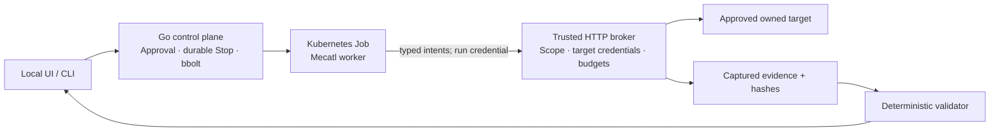

# Tsunami

Tsunami demonstrates how to run an explicitly authorized web-application assessment with customer credentials while keeping enforcement outside the agent. The operator approves a bounded plan; the worker requests actions through a trusted Go broker; captured evidence determines the result.

This is an owned-lab prototype for infrastructure/security review. It is not a production customer platform or autonomous vulnerability discovery.

## What works today

The local UI supports Add Application → approved prerequisite checks → exact Scope Review → Approve → Start → actual activity → finding/evidence/remediation → separately approved fixed-app retest. A CLI uses the same control API. Nothing displayed as activity or a finding is fabricated.

Configured applications use a scripted provider driving the real Mecatl engine. The owned demo uses vulnerable/fixed VAmPI for cross-user object access, separate property-exposure controls, a rejected scope escape, and a held-request fixture for Stop. Results remain `confirmed`, `no_issue_observed`, or `inconclusive`; human impact/severity review is separate.



The worker has two tools: request an approved HTTP read and request trusted validation. It cannot expand scope, obtain target credentials or confirm a finding. The selected lab uses gVisor and Cilium, with separate runtime/network checks. [Mecatl integration](docs/mecatl-harness.md) explains the division of responsibility.

## Reproduce the controlled demo

Start with the **[prepared-environment demo guide](docs/demo-walkthrough.md)**: prerequisites, credential/capacity checks, loopback UI access, build qualification and the exact five-minute script. It requires the dedicated owned Kind lab; a clone alone does not provision it. The guide links the lab bootstrap instructions.

Safe source checks from the repository root:

```sh
make verify
make verify-ui-retest
```

Use the Go/toolchain versions pinned in [go.mod](go.mod), Python 3 and Node 22. Browser checks additionally require Chrome; Kubernetes qualification requires Docker, Kind, kubectl, Helm, gVisor and Cilium in the documented lab. Optional schema/toolkit checks have separately documented inputs. The [retained D9 dossier](examples/demo-journey/README.md) records its exact build, outcomes and 300-second automated browser rehearsal; it does not certify a later build or current credentials. The [Stop-patch verification](docs/archive/stabilization-2026-11-09.md) records the newer build and a separate core-only rehearsal.

## Safety and limits

Only owned/local/intentionally vulnerable targets with disposable synthetic data are included. Scope pins origin, addresses, account/path pairs, methods, expiry and budgets. DNS, numeric-IP dialing, redirects and TLS remain broker-controlled. Stop durably revokes permission and cancels tracked local work; revocation, drain, worker exit and cleanup are distinct observations. It cannot undo remotely accepted actions or provide a production partition/latency guarantee.

Customer login/billing, general discovery/authentication, independently qualified tenant isolation, general evidence redaction/retention, external emergency cutoff and production scale/failure guarantees are unfinished. Optional private/model experiments are outside this demo. [Security](docs/security.md), [design](docs/design.md), [current status](docs/track.md), [remaining work](docs/roadmap.md), and the [historical/reference index](docs/archive/README.md) make those boundaries inspectable.
