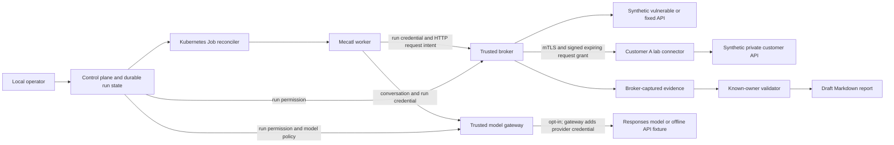
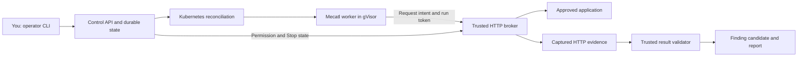

# Tsunami

A small API security-testing lab using the Mecatl agent engine and Kubernetes Jobs.

The original workflow checks whether one test user can read another user's private document. A versioned catalog now adds opaque object IDs, approved sharing, administrator access, unauthenticated reads, and a missing-object control. The broker captures evidence, enforces scope, and cancels active requests when stopped.

**Current status: a working synthetic lab with five embedded authorization procedures and configured object/property read profiles. Scripted execution is the default. Offline checks pass; live free-model evaluations retain both successful and incomplete results. This is not an autonomous pentest product or a qualified sandbox for hostile agents.**

**Current delivery:** the connected five-minute owned-lab journey is [qualified on the D9 build](examples/demo-journey/README.md): Add Application, exact scope approval, real activity, finding/evidence/remediation, active-request Stop and a fresh linked fixed-app retest. A paced automated browser dry run completed in 300.000 seconds; it is not recorded human narration or customer readiness. Use [the presenter script](docs/demo-walkthrough.md#five-minute-presentation), [goal](docs/project-goal.md), [tracker](docs/track.md), [ordered tasks](docs/roadmap.md), and [design](docs/design.md). Present this slice and collect feedback; broader execution profiles and customer-platform expansion remain deferred. The earlier [review follow-up](docs/review-follow-up.md) retains its own history.

The [operator CLI](docs/operator-cli.md) now connects configured application selection, draft scope review, explicit approval, one scripted attempt, monitoring, Stop and private evidence export. The [recorded CLI campaign](examples/operator-journey/README.md) covers the owned vulnerable/fixed API pair and Stop after a watch timeout. A URL-only assessment is not implemented. The opt-in [local UI](docs/local-ui.md) connects these APIs with Dashboard/onboarding, readable scope, actual activity/Stop, body-free finding/evidence/remediation navigation and linked retests with fresh scope approval. Raw artifacts require explicit inspection. Source checks do not replace qualification of a matching deployed build. This is not a customer portal.

The new [property-access profile](docs/property-access.md) checks whether an allowed shared-record response exposes owner-only fields. Its [owned campaign](examples/property-access/README.md) records a known-value leak, correct filtering, an inconclusive redacted value and active-request Stop using the same fixed curl/broker boundary. It adds no state-changing operations or mass-assignment testing.

[Binding preparation](docs/binding-preparation.md) now derives the registration plan from supplied synthetic baseline facts. It performs no network requests and grants no execution permission. Fresh [runtime records](examples/binding-preparation/README.md) link six prepared plans to their approved runs. The [CLI showcase package](docs/showcase.md) now has a fresh seven-case rehearsal, network controls and a short presenter guide; the two scoped showcase milestones are complete. This is a controlled demonstration, not customer readiness.

For the existing dedicated sandbox, start with `make showcase-check`. If owned fixture credentials need refreshing, `make showcase-prepare` explicitly resets disposable lab data while preserving history. Then `make showcase` runs the core API/Stop cases, or `make showcase-extended` includes property-access controls. These use scripted Mecatl and no external models. See [the retained results](examples/showcase/README.md) and [setup/recovery instructions](docs/showcase.md).

[Application onboarding](docs/application-onboarding.md) now provides a form, durable checked questions, protected bearer access, explicitly approved four-read validation and atomic registration of a supported application plus an unapproved assessment draft. The setup advisor is rule-checked, not a live LLM. Unknown backend URLs are asked for; password/SSO methods are marked unavailable. Final assessment approval/Start are still required. New integrations support only the documented synthetic bearer/JSON contract, not arbitrary website assessment.

For initial frontend enablement, use `make ui-deploy`, then a loopback control-service port-forward and open `http://127.0.0.1:8080/ui/`. If the UI is already enabled on the selected qualified build, port-forward without rebuilding. The [demo configuration](docs/demo-configuration.md) fixes the owned targets, procedures and readiness/qualification steps; the [UI guide](docs/local-ui.md) covers private operator connection. The [API-by-API walkthrough](docs/demo-walkthrough.md) describes existing behavior. Application password login and AccuKnox integration are not implemented.

Run `make verify` for fresh Go race tests, vet, Python tests and checked-in export integrity. Python validator dependencies are in `scripts/requirements-test.txt`; full setup is in the follow-up. `make verify-toolkit TOOLKIT_PATH=../vapt-toolkit` additionally validates the actual separately obtained local schemas. These commands make no external model or customer-target calls.

## What runs today

- By default, the real [Mecatl Go engine](https://github.com/stacklok/mecatl), pinned to `engine/v0.18.1`, drives tool calls using its scripted adapter. That mode needs no model API key and incurs no model bill.
- An operator API owns durable run state in bbolt. Kubernetes mounts a PVC for that state.
- A namespace-scoped reconciler creates one short-lived Kubernetes Job and credential Secret per run. Workers have no Kubernetes API token or RBAC permissions.
- A separate HTTP broker checks the approved origin, port, path, and chosen address. It pins approved addresses at lab startup, validates each redirect, ignores proxy environment variables, and keeps TLS verification enabled.
- The broker owns request limits, cancellation, and evidence capture. The worker cannot submit a confirmed verdict.
- A deterministic validator checks the approved synthetic ownership, sharing, and role rules against captured responses. Missing prerequisites can receive bounded, scoped feedback; model text cannot confirm a finding.
- Run, tenant, and global stops are durable. A stale/restarted worker cannot use a stopped run's credential to send broker requests.
- Reports use synthetic account aliases and omit operator/run credentials.
- The optional model path keeps the provider key in the control plane, reserves calls before forwarding, records usage, and cancels inference on Stop. Workers retain the same restricted network path and tools.
- Per-call diagnostics separate observed model failures from incomplete assessments. A local failure harness tests partial streams and cancellation without external model calls; unknown historical causes stay unknown.
- An operator-approved engagement groups bounded child runs, derived checklist progress, evidence-linked finding candidates and engagement-wide Stop. Optional local toolkit inspection records coverage gaps without executing its scripts.
- A configured HTTP application profile verifies account identities and object access without changing fixture code. VAmPI runs in the owned lab; reviewed JSON/evidence, CSV and Markdown exports have contract/integrity checks. Application execution is currently scripted and uses synthetic data.

## Important boundary

The original `kind-kind` cluster **did not pass** the runner network test. Fresh runners reached the target before policy settled, and could still reach the node API afterward. The stronger test uses an ingress-unrestricted tripwire, checks startup separately, and confirms the same destinations are reachable from a trusted probe before and after the runner test.

A separate `tsunami-lab` cluster now has Cilium default-deny networking and gVisor. The tested target, API, and DNS paths are blocked there while the broker is reachable. The runtime smoke test checks an actual pod through CRI, not just a RuntimeClass object. See [sandbox setup and boundaries](docs/sandbox-lab.md).

The current worker registers **no general shell, filesystem, arbitrary fetch, or external scanner tool**. Its default scratch image has no shell. The optional [reviewed curl adapter](docs/tool-execution.md) uses a separate gVisor tools image and sends request intents through the broker. We have not qualified hostile-process containment or tested every node, metadata, DNS, and IPv6 path. Do not confuse a successful broker check with complete containment.

The server still requires `TSUNAMI_ALLOW_UNSANDBOXED_LAB=true` to acknowledge the limited synthetic lab. The manifest sets it explicitly. Passing the listed checks does not make this a production or fully qualified hostile-code sandbox.

Untrusted shell execution needs a tested sandbox runtime, enforced networking, and bypass checks before it is enabled. Ordinary containers can run HTTP/API tools; they are not automatically an equivalent security boundary to your tester's VMs.

## Architecture





The control plane, HTTP broker, model gateway, and validator are modules in one Go process for now. Workers, fixtures, and the optional private connector run in separate pods. The private lab has a customer namespace, exact target approvals, single-use request grants, and a local emergency cutoff. Broker-to-connector traffic now uses mutual TLS with separate broker/operator identities. It does not connect to a real customer's network.

## Run locally

Requires Go 1.27.3; `go.mod` pins the toolchain. The first build downloads Go/modules if they are not cached.

```sh
make test
make local-demo
```

The local demo uses loopback HTTP fixtures and an in-process worker. It does not claim process isolation. It writes machine-readable evidence and Markdown reports to `artifacts/local/`:

| Scenario | Expected result |
|---|---|
| `vulnerable` | `confirmed`: Bob receives Alice's known private fixture document |
| `fixed` | `no_issue_observed`: own-document baselines pass; cross-user request is forbidden |
| `inconclusive` | A nonexistent object cannot prove authorization works |
| `redirect` | The broker rejects an unapproved redirect; the tripwire receives no request |
| `stop` | An active slow request is cancelled; the broker accepts no further run requests |

Every scenario also attempts an unapproved origin. It is rejected before target DNS resolution. Only local fixtures receive test traffic.

## Optional model path

`make model-fixture-demo` exercises Mecatl's real Responses adapter against a local API fixture, without a key or paid calls. On the dedicated cluster:

```sh
export KUBECONFIG="$PWD/.local/sandbox.kubeconfig"
make configure-model-fixture CONTEXT=kind-tsunami-lab
make model-fixture-eval CONTEXT=kind-tsunami-lab
```

The evaluator records the vulnerable/fixed pair and collects its exact run IDs. Provider/model/prompt/tool settings stay at the broker. Missing evidence stays inconclusive; model text cannot declare a finding confirmed. The regular five-case verifier remains scripted even when this path is configured.

Real inference requires an explicit model, key-file configuration, and an explicit evaluation action. See [setup, limits, and remaining work](docs/model-path.md). The current [recorded model-path examples](examples/model-path/README.md) use a wire fixture, not a real LLM.

The separate [free-model trial](examples/free-model/README.md) used `nvidia/nemotron-3.5-lightning:free` through OpenRouter. It confirmed the vulnerable fixture, returned `no_issue_observed` for the fixed fixture, and drained an active inference request in 29 ms after Stop. The account reported $0 usage after 12 free requests. These are single lab observations, not accuracy or availability guarantees.

The `openrouter-free` profile pins the official endpoint and an explicit `:free` model, disables fallback/plugins, and sends zero prompt/completion/request price ceilings. Workers cannot change these settings. See [free-only setup and evidence](docs/openrouter-free.md). No paid fallback is attempted when a free route is unavailable.

`make inference-diagnostics` runs 14 controlled Responses cases locally, without a model key or target traffic. It checks error categories, cancellation, partial-tool buffering, and uncertain usage. [Diagnostic notes](docs/inference-diagnostics.md) also explain how to analyze archived catalog runs without changing their verdicts. The earlier live scores remain 3/4 and 2/4; their detailed results are retained.

## Run on Kubernetes

Requires an existing local Kind cluster, Docker, kubectl, and Python 3. Commands use explicit context `kind-kind` by default; they do not change your current context or replace the CNI.

```sh
make deploy CONTEXT=kind-kind
make verify-k8s CONTEXT=kind-kind
make collect-k8s CONTEXT=kind-kind
```

Deployment builds a local `tsunami:dev` image, loads it into Kind, and creates resources only in the `tsunami` namespace, plus that namespace's Pod Security labels. It generates random operator credentials on first deployment; credentials are not committed or printed. Re-deploying restarts this project's deployments to pick up the development image. The commands above exercise the basic lab on the original cluster; they do not qualify its isolation.

For the separate gVisor/Cilium lab:

```sh
make sandbox-cluster
export KUBECONFIG="$PWD/.local/sandbox.kubeconfig"
make deploy CONTEXT=kind-tsunami-lab RUNTIME_CLASS=gvisor
make isolation-check CONTEXT=kind-tsunami-lab
make verify-k8s CONTEXT=kind-tsunami-lab
```

This setup installs pinned runtime files inside the new Kind node and uses a separate kubeconfig. It does not replace the original cluster's CNI or install a runtime on the host. See [the setup notes](docs/sandbox-lab.md) for prerequisites and cleanup.

Verification launches a Job that starts real Mecatl worker Jobs and checks all five scenarios. The API retains run evidence in its PVC. `collect-k8s` reads the local operator Secret using your kubectl access, opens a temporary loopback-only port-forward, and exports the latest run of each scenario to `artifacts/kubernetes/`. It never exports the credentials.

Inspect the lab:

```sh
kubectl --context kind-kind -n tsunami get pods,jobs
kubectl --context kind-kind -n tsunami logs deployment/tsunami-control
```

Check the original cluster separately (expected to fail):

```sh
make isolation-check CONTEXT=kind-kind
```

A failure here is an actual unmet security prerequisite, even when the workflow verification passes. Do not replace a failed check with a claim that the cluster is safe.

The current network probe opens TCP connections without issuing tripwire application requests, so it does not increment assessment counters.

## What the result proves

The validator requires successful reads of Alice's own object and Bob's own object before evaluating Bob's read of Alice's object. A `200` alone is insufficient: the returned ID, owner, and synthetic private content must match. A missing object or missing baseline stays inconclusive.

The result applies to these recorded requests and this fixture's known rules. It does not prove application-wide security, infer ownership in arbitrary applications, or assign a real-world severity automatically. See [the workflow](docs/workflow.md).

## Authorization catalog

```sh
make catalog-local
make catalog-fixture-local
# After deploying the current image in the dedicated lab:
make catalog-verify CONTEXT=kind-tsunami-lab
make catalog-private-verify CONTEXT=kind-tsunami-lab
```

Each default suite runs five procedures against both fixture variants twice: 20 runs. Scripted execution and the offline Responses fixture are separate from real inference. The operator selects an embedded procedure; the run pins its definition/digest and six-request budget. The broker and private connector enforce its exact account/path pairs. Anonymous access is an explicit capability, not arbitrary header control.

The validator distinguishes a forbidden read from an intentional share and a missing object. Premature completion receives at most two trusted missing-evidence responses without expanding scope or budgets. These are initial engineering procedures, with security-engineer review still pending. See [catalog and evaluation rules](docs/assessment-catalog.md), [toolkit mapping](docs/toolkit-mapping.md), and [recorded results including live-model failures](examples/assessment-catalog/README.md).

Actual synthetic reports from gVisor worker Jobs are in [examples/sandbox-kubernetes](examples/sandbox-kubernetes/README.md), including the [confirmed finding](examples/sandbox-kubernetes/vulnerable.md), [fixed case](examples/sandbox-kubernetes/fixed.md), and [stopped run](examples/sandbox-kubernetes/stop.md). The original ordinary-container samples remain in [examples/kubernetes](examples/kubernetes/README.md).

## Stopping

The control plane persists a disabled run/tenant/global gate before acknowledging stop. It cancels active broker contexts immediately; the reconciler separately deletes the run Job and Secret. Neither Job deletion nor a worker's claim is used as evidence that network activity stopped.

The broker checks durable state for each outbound request and reserves quota before forwarding. Target requests have a ten-second timeout; model calls have a twenty-second timeout. Both are cancelled on durable stop. These are **request timeouts**, not renewable distributed authorization leases. The optional private connector additionally enforces signed single-request expiries and a persisted emergency cutoff independent of the broker process. An external network cutoff and production partition testing remain future work. Cancelling a model request does not prove the provider stopped computing or billing.

The demo measures operator stop-call to broker drain, then checks that request count does not grow. The target also observes cancellation of the active request. These local observations are not a validated 60-second guarantee under arbitrary partitions. Requests already accepted by an application cannot be undone.

The [Stop lifecycle milestone](docs/stop-lifecycle.md) adds operator status separating permission, execution, local activity and cleanup. A real gVisor/curl campaign covers run/engagement Stop, denied controller API access and restart after committed revocation. [Recorded results](examples/stop-lifecycle/README.md) keep target cancellation and CRI worker exit separate. Optional configuration failures disable their execution route while leaving state/revocation readiness available.

## Private connectivity lab

```sh
export KUBECONFIG="$PWD/.local/sandbox.kubeconfig"
make private-deploy CONTEXT=kind-tsunami-lab
make private-verify CONTEXT=kind-tsunami-lab
make connector-tls-check CONTEXT=kind-tsunami-lab
PROBE_PRIVATE=true make network-check CONTEXT=kind-tsunami-lab RUNTIME_CLASS=gvisor
make connector-network-check CONTEXT=kind-tsunami-lab
```

Run the network checks after verification restores the connector from its deliberate outage. Customer A's synthetic apps live in `tsunami-customer-a`. The broker sends signed, single-use, expiring permissions to that customer's connector; workers still use only the broker. Customer B's fixture supplies a separate negative test. The private route is opt-in and currently scripted.

The five scenarios, tenant binding, and connector outage checks pass. Local tests also cover replay after restart, request/certificate expiry, and a persisted emergency cutoff. The connector checks both the TLS identity and the signed grant; there is no plaintext fallback. The other HTTP links and synthetic account credentials are lab limitations. See [private design](docs/private-connectivity.md), [TLS and renewal limits](docs/connector-tls.md), and [current transport results](examples/connector-tls/README.md). The older [private connector records](examples/private-connectivity/README.md) retain the original HTTP experiment.

## Project layout

```text
cmd/tsunami/          CLI: serve, worker, lab, local-demo, verify, collect-k8s
internal/platform/   durable state, identity checks, scope, broker, validation, reports
internal/worker/     Mecatl engine and two constrained tools
internal/kube/       namespace-scoped Job/Secret reconciliation
internal/lab/        intentionally vulnerable and fixed synthetic APIs
internal/demo/       end-to-end verification and artifact collection
internal/isolation/ trusted network and runtime diagnostics, not agent tools
internal/inference/ fixed model contract, provider transport, offline API fixture
internal/connector/ private lab scope enforcement, signed grants, replay and cutoff state
internal/assessment/ embedded procedure definitions and canonical policy digests
deploy/             local lab, verifier, and network-probe manifests
docs/               workflow, threat boundaries, and next steps
```

## What is intentionally unfinished

The [reviewed tool adapter](docs/tool-execution.md) adds an actual shell/curl execution path for configured read plans, with independent broker and network enforcement. It does not enable arbitrary commands or unmodified toolkit scripts.

The [application adapter](docs/application-adapters.md) now exercises an existing API and supports explicit finding reviews plus the three toolkit export contracts. Its checklist mappings are partial samples. `make application-setup CONTEXT=kind-tsunami-lab` seeds only the disposable owned VAmPI lab; `make application-verify CONTEXT=kind-tsunami-lab` runs its configured read plans without model calls. This adds a working application path, not general customer assessments or autonomous discovery.

The immediate delivery is the [bounded HTTP product demo](docs/roadmap.md), not a complete VAPT platform. VM/MCP, network/mobile/cloud testing, specialist agents and general customer-platform work are deferred. [The engagement foundation](docs/engagements.md) is implemented; `make engagement-fixture-local` exercises it without external model calls. Existing toolkit scripts and additional execution profiles are not enabled by that foundation. Customer use retains separate identity, isolation, secret/evidence lifecycle and operational qualification requirements.

Full network/runtime qualification, arbitrary shell/scanner integration, measured general vulnerability discovery, real customer-network tunnels, a customer portal, secret-manager integration, evidence retention automation, customer-wide monetary spend reservations, and production telemetry are not implemented. Model call/attempt limits and usage counters are not a dollar spending guarantee. The free-only profile also trusts OpenRouter to honor its routing and pricing controls. This is not a production multi-tenant service. The initial databases store credentials/state locally; worker/broker and connector/fixture links remain HTTP. Only synthetic credentials/data are supported.

See [observed results](docs/validation-results.md), [security boundaries](docs/security.md), and [next steps](docs/roadmap.md). The testing workflow was informed by a security engineer's VAPT toolkit; its scripts and agent prompts are not copied or executed. [OWASP's object-reference testing guidance](https://owasp.org/www-project-web-security-testing-guide/v42/4-Web_Application_Security_Testing/05-Authorization_Testing/04-Testing_for_Insecure_Direct_Object_References) provides the underlying testing principle.
