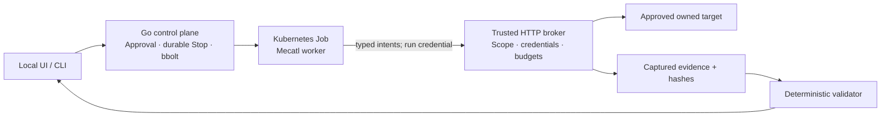

# Tsunami

Tsunami is a Go prototype for running explicitly authorized web-application security assessments. It keeps scope approval, target credentials, request enforcement, evidence and Stop controls outside the agent's authority.

The supported demo tests owned synthetic applications. It uses the real Mecatl engine with scripted tool calls, Kubernetes Jobs and a trusted HTTP broker. It does not perform autonomous vulnerability discovery.

## Quick Start

### Path A — verify the source locally

Prerequisites: Linux amd64, Git, make, a C compiler for Go race tests, Go **1.27.4** (see [go.mod](go.mod)), Python **3.13** with venv/pip, Node **22**, `/bin/sh` and `/usr/bin/curl`. These are tested versions, not a compatibility matrix. Docker, Kubernetes and model API keys are unnecessary for this path.

```sh
git clone https://github.com/Sanskarzz/tsunami.git
cd tsunami
python3 -m venv .local/test-venv
. .local/test-venv/bin/activate
python3 -m pip install -r scripts/requirements-test.txt
make verify
make verify-ui-retest
make build
```

Expect passing Go race tests/vet, Python and frontend tests, evidence-integrity checks, and `bin/tsunami`. Tests use disposable local state and owned loopback fixtures; no lab deployment or external model call is required. [Getting Started](docs/getting-started.md#path-a--verify-the-source-locally) explains expected results and optional browser tests.

### Path B — run the controlled Kubernetes demo

Use the [Kubernetes Getting Started path](docs/getting-started.md#path-b--run-the-controlled-kubernetes-demo). It requires a dedicated Linux/Docker/Kind lab with Cilium and gVisor, synthetic targets and private operator access. **The complete fresh-environment bootstrap is not yet qualified.** A clone does not provision the lab. Do not use bare `make deploy` or adopt an existing cluster implicitly.

## What the assessment does

Add an owned application → approve four legitimate prerequisite reads → review and approve exact scope → Start → observe broker activity → inspect finding/evidence/remediation → separately approve a fixed-app retest. Stop can revoke active work. A fixed out-of-scope intent is visibly rejected before contacting its destination.

The bounded procedures cover cross-user object access and private-field exposure. Results are `confirmed`, `no_issue_observed` or `inconclusive`. Confirmation requires captured evidence; human impact/severity review remains separate. See [supported functionality and limitations](docs/current-status.md).



The worker has only `http_request` and `finish_assessment`. The broker checks approved origin, destination addresses, account/path pairs, redirects, DNS, TLS and budgets. Target credentials stay trusted-side. Stop persists revocation and cancels tracked local work; drain, worker exit and cleanup are separate observations.

The gVisor/Cilium lab has selected runtime/network evidence, including retained failures. It is not a proven hostile-agent sandbox or production tenant-isolation platform. General discovery/login, customer accounts, complete secret/evidence lifecycle controls and production failure/scale guarantees remain unfinished.

## Documentation and verification

- [Documentation index](docs/README.md), [architecture](docs/design.md) and [security boundaries](docs/security.md).
- [Verification and historical evidence](docs/verification.md); results qualify their recorded builds only.
- [Prepared-environment demo script](docs/demo-walkthrough.md) and [Mecatl integration](docs/mecatl-harness.md).
- [Security reporting](SECURITY.md).

Repository licensing is pending the owner's final decision. No project-wide open-source license has been granted yet; dependencies retain their own licenses. See [ownership and attribution review](docs/current-status.md#licensing-and-attribution).
