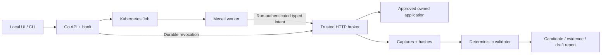

# Architecture and state model

Tsunami keeps authorization and evidence authority in the trusted Go control plane. The default configured-application workflow is scripted Mecatl. [Current status](current-status.md) defines supported capabilities; [verification](verification.md) identifies qualified builds and omissions.



## Authority and implementation

The API, broker, validator, store and optional model gateway share one trusted process. Workers, targets and optional connectors run separately. There is no custom Kubernetes CRD or distributed workflow engine.

| Component | Responsibility | Code |
|---|---|---|
| Operator API/store | Tenant bearer authorization, immutable scope, reviewed-digest approval, atomic keyed Start, durable Stop | [platform](../internal/platform/) |
| Scheduler | Per-run Secret and Job, configured runtime, no API token in worker, no automatic replay of uncertain dispatch | [scheduler](../internal/kube/scheduler.go) |
| Worker | Real Mecatl engine, exactly `http_request` and `finish_assessment`, bounded turns/calls | [worker](../internal/worker/worker.go), [harness contract](mecatl-harness.md) |
| Broker | Credential custody, exact account/path scope, numeric-IP dialing after DNS checks, redirects/TLS/budgets, captures/cancellation | [scope](../internal/platform/scope.go), [requests](../internal/platform/server.go) |
| Validator/reporting | Captured evidence plus approved facts; no worker-authored verdict or automatic severity | [application validation](../internal/platform/application.go), [finding views](../internal/platform/finding_view.go) |
| UI/CLI | Operator-authorized real metadata and explicit evidence reads; stale/uncertain observations remain visible | [UI](local-ui.md), [CLI](operator-cli.md) |

The scratch native worker and optional fixed curl adapter use the same broker boundary. Curl submits typed intents through a private Unix bridge; the broker opens target connections. No arbitrary shell or unrestricted networking is exposed as an agent tool. Cilium/gVisor have separate selected-path qualification; configuration alone is insufficient. See [security](security.md).

## Product terms

An **application** supplies registered target/account/object facts. A **procedure** is a versioned bounded test. An **engagement** is an immutable saved approval scope with child runs; the UI calls it an assessment. A **run** is one attempt. A **finding candidate** is an evidence-supported observation awaiting human impact/severity review. Different object owners alone do not establish forbidden access.

## Journey and backend transitions

All operator routes are tenant-authorized. Run tokens cannot approve, create siblings, inspect engagement evidence or review findings. [Engagement contracts](engagements.md) and [onboarding](application-onboarding.md) describe full request/response behavior.

| Screen/action | Backend source or transition |
|---|---|
| Dashboard | `GET /v1/applications`, `/v1/engagements`, `/v1/onboarding`; saved scope and latest-attempt metadata, no synthetic counters |
| Add Application | `POST /v1/onboarding`, typed answers/details/access; saves facts without target traffic |
| Prerequisite review | Explicit revision/digest-bound `/validate`; only four legitimate reads; `ready_for_validation → validating → ready_for_approval`, or failed/interrupted/expired/stopped |
| Prepare / Scope Review | `/prepare` atomically registers a supported application and an engagement `draft`; show target/addresses/account/GET/path/rule/budget/expiry/executor |
| Approve | Engagement `/approve` compares reviewed `scope_digest` with canonical saved scope; `draft → active`, no dispatch |
| Start | `/runs` atomically reserves child/credential/action key; run `pending`, then reconciliation commits dispatch intent and moves it to `running` |
| Assessment | `/status` and cursor `/events`; actual admission/send/capture/rejection/validation and lifecycle observations |
| Finding / Evidence | `/findings` returns body-free selected proof metadata; explicit `/evidence/{E-sha256}` returns one exact artifact, verified before display; full `/export` is separate |
| Remediation | Deterministic procedure-specific guidance; no invented patch, review or severity |
| Stop | Run/engagement/tenant/global routes persist revocation before acknowledgement and cancel tracked work; cleanup follows independently |
| Retest | New draft via `source_engagement_id` and an explicitly selected registration; fresh scope review/approval/Start; `/retest` compares actual outcomes and compatibility |

Setup can also be `needs_input`, `unsupported`, `validation_failed`, `interrupted`, `expired`, `stopped` or `assessment_created`. Registration and approval remain separate. New public onboarding supports only reviewed HTTPS bearer/JSON contracts with synthetic data; private exceptions are exact registered lab integrations.

Engagement authorization is `draft → active → stopped`, with expiry checked separately. A completed child does not invent an engagement `completed` state. Runs are `pending → running → completed | failed | stopped`; `running` at dispatch is not process proof. Status separates:

- Permission: active, revoked, expired, closed or not active.
- Execution: queued, dispatch intent, observed worker/exit, or unknown.
- Activity: active locally, no local work, drained locally, or prior-process uncertainty.
- Cleanup: not requested, pending, deletion accepted or API resources absent.
- Assessment: `confirmed`, `no_issue_observed`, `inconclusive`, or no completed result.

A stored request reservation is not necessarily a target request in flight. A missing response leaves a stale/unknown observation, not a new successful state. A lost Start response is recovered through child IDs or the exact original action key; recovery returns current stored state without replacement work, renewed deadlines or refunded budget. New attempts need new keys and normal admission. See [Start recovery](engagements.md#start-recovery).

Stop is a branch from active work. A separately approved held-request fixture makes cancellation observable; stopping already completed work does not demonstrate active cancellation. Stop cannot undo a remote effect or infer exit from resource absence. Changed target/access requires fresh scope approval. A retest preserves source evidence and labels incompatible rules; a clean configured check is not whole-application security.

## Activity events

A typed `activity` journal shares each run's bbolt record. Legacy free-text `events` remain compatible and are never copied into the activity feed. The UI connects this journal to the observed activity panel; scope/approval history remains separate.

The operator endpoint requires the run's tenant credential; worker/run credentials cannot read or write it. Reads perform no target or executor observation:

```text
GET /v1/runs/{id}/events?after=<sequence>&limit=50
```

`after` is an exclusive nonnegative sequence cursor, initially `0`; omitted `limit` defaults to 50, with a range of 1–100. Unknown/duplicate query keys, empty/noninteger values, unsafe JSON integers and cursors beyond the stored latest sequence return 400. Wrong-tenant reads return 404; unauthenticated/run-token reads return 401; mutations return 405. Responses use `Cache-Control: no-store`.

Each run retains at most **256 events**, each at most **2,048 JSON bytes**. Oldest records are evicted without blocking new revocation/cleanup records. This is a demo activity journal, not an immutable audit archive. Oversized future-producer details become `code: details_unavailable`, preserving the event envelope. No message bus or separate tracing service is involved.

Responses contain `items`, `next_cursor` (last returned sequence, unchanged for an empty page), `oldest_sequence`, `latest_sequence`, `has_more`, `history_truncated`, `gap` and `tracked_from_creation`. All describe one database snapshot. `has_more` requires another bounded page; `gap` means retention removed events after the supplied cursor; `history_truncated` remains true after catching up. Empty journals have oldest/latest `0`. Older runs start with no journal and `tracked_from_creation: false`; later observations may create a partial journal without reconstructing earlier facts.

Common fields: `schema_version: 1`, per-run monotonic `sequence`, `recorded_at`, `kind`, trusted `source`, `run_id`, optional `engagement_id`/`procedure_digest`, optional `operation_id`/`capture_id`, and typed `data`. Legacy runs without a pinned procedure digest omit it. Tenant identity comes from backend state/authentication. Source is assigned by trusted code: `control_plane`, `controller`, `broker` or `validator`. Sequence orders persistence; observed timestamps describe facts that may have happened before persistence, including a send observed near Stop.

| Implemented event | Safe `data` fields and meaning |
|---|---|
| `run.created` | `execution_mode`, `executor`, `request_limit`, `deadline`, from the bound run policy. |
| `execution.dispatch_requested` | `observed_at` for durable dispatch intent; not Job creation or worker-start proof. |
| `execution.worker_observed` | `observed_at`, only on an actual running-worker observation. |
| `execution.failed` | `code: worker_failed`, `observed_at`; the existing worker-failure transition remains inconclusive without automatic replay. |
| `request.admitted` | `read_index`, `account_slot`, `reservation`, `observed_at`; atomic with the durable request reservation, not target receipt. |
| `request.sent` | `observed_at` from successful HTTP `WroteRequest`; not response success or target-side processing proof. |
| `request.rejected` | `code: scope_not_approved`, `stage: scope`, atomic with the blocked capture. No arbitrary rejected URL/account echo. |
| `request.capture_persisted` | Optional HTTP `status`, `duration_ms`, `outcome`: `response_captured`, `blocked`, or `failed_or_interrupted`. A capture does not confirm a finding. |
| `validation.completed` | Trusted `verdict`, available `validation` counts (`required`, `verified`, `probe_captured`), bounded `evidence_ids`; atomic with the completed result. |
| `permission.revoked` | `code`: `run_stop`, `engagement_stop`, `tenant_stop`, `global_stop`, `deadline` (or `unspecified`), `observed_at` equal to durable revocation time. |
| `activity.drained_locally` | `observed_at`, only after tracked local operations drain; uncertain prior-process operations prevent this claim. |
| `execution.exit_observed` | `observed_at` for an actual exit observation. |
| `cleanup.delete_accepted` | `observed_at` for Kubernetes deletion acceptance. |
| `cleanup.resources_absent` | `observed_at`, after deletion acceptance; not process-exit proof. |

`read_index` is 1-based into the first matching account/path pair in the reviewed procedure; repeated rechecks may reference that same first read. It does not claim enforced ordering or exactly-once execution. `account_slot` numbers accounts by first appearance in that procedure, without exposing configured aliases. Legacy lab runs use the broker's closed Alice/Bob document/slow/redirect catalog. Rejected arguments never receive an invented approved-read reference.

DNS/TLS/connect failures have an admitted reservation and a failed capture, with no successful-send event. Redirect hops are separately validated/reserved/captured. The frozen private connector callback supplies no trusted write observation, so it emits no `request.sent`; admission is never used as a substitute. Failed executor checks and unfinished validation feedback do not invent successful lifecycle/validation events. Consult lifecycle status for current observations and uncertain-operation counts; this journal does not replace it.

Durable transitions and their events share the relevant state transaction, including engagement/tenant/global revocation. Send observations are persisted after the actual write; a crash/storage failure can leave an admission without a send or completion observation. Never backfill imaginary events for older runs. No worker-authored event ingestion endpoint exists; missing completion after a crash remains uncertain.

Use approved operation references and account slots rather than arbitrary tool arguments. Do not stream headers, tokens, cookies, raw bodies, prompts, model reasoning, arbitrary errors or unapproved URLs. Even a rejected URL can contain secrets. Resolve references to reviewed scope only when needed; raw evidence uses existing tenant-authorized explicit inspection. Render all target/metadata text as untrusted text.

Keep Stop independent of polling and telemetry delivery. Do not delay revocation for an event consumer. Local drain must not be labeled target-observed cancellation; the owned fixture's separate counters/qualification supply that evidence when actually collected.

## Activity presentation and independent Stop

The assessment screen renders only returned records, their trusted source, sequence, persistence/observation times and bounded request/evidence references. It distinguishes reservation, observed write, persisted capture, rejection and trusted validation. A count of scope rejections in displayed records and **Show scope rejection** make the actual rejected intent inspectable without loading raw evidence. It displays at most 256 received records and explains both server retention gaps and local display truncation. Unknown historical tracking remains unknown; incompatible pages are not promoted.

One refresh is in flight per selection. Manual refresh shares it; the polling loop schedules its next 1.5-second delay only after the current refresh finishes. Scope is read first; status and the bounded event pages then load independently, retaining separate stale/error states. At most six 50-event pages load in one refresh. Sequence checks prevent duplicates and mismatched-run/source/schema records; cursor state resets on run/assessment changes. Existing values and their timestamps survive failed reads.

Pause, leaving the execution screen, switching selections and disconnect cancel obsolete viewer reads. Generations/connection identity prevent late responses from changing the current selection. None sends Stop. Returning to the execution screen requires explicit Resume for continued polling. The loop ends on errors, explicit pause/navigation, 120 refreshes, a stopped empty scope, or observed resource cleanup with known zero local/uncertain operations and no pending event pages. Ending observation never proves process exit or changes permission.

The contextual Stop control remains visible across assessment/evidence screens. It bypasses the Start/export action lock, cancels the obsolete observation read, and sends the existing engagement Stop mutation independently. The receipt distinguishes pending, acknowledged and unacknowledged requests; it does not wait for follow-up reads. A later stored engagement read can separately establish revocation after a lost response without rewriting that response as acknowledged. Mutations are never automatically retried. Any Stop request blocks another Start in the loaded viewer while its outcome is being resolved. Late Start/export/status responses cannot erase the separate Stop receipt.

Permission, broker activity, execution and cleanup remain separate status cards, with actual lifecycle timestamps/uncertain-operation counts. Local drain is not target-observed cancellation. Deletion acceptance and API resource absence are not worker-exit proof. A confirmed finding still requires trusted captured evidence, and Stop is not a successful assessment.

## Verification boundary

Use [source and browser checks](verification.md) for code changes and separate runtime/network/assessment campaigns for a selected deployment. Historical evidence retains its original build/date, including failed isolation and model results. Never substitute it for a claimed live observation. [Getting Started](getting-started.md) owns setup; [the demo walkthrough](demo-walkthrough.md) owns the prepared presentation.
