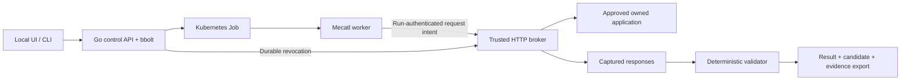

# Tsunami: demo architecture and product journey

Updated: 2026-11-09. Scope: [project goal](project-goal.md). Current implementation: [tracker](track.md). Ordered changes: [roadmap](roadmap.md).

D3 metadata, D4 activity events, D5 activity/Stop, D6 Dashboard/onboarding/scope, D7 finding/evidence/remediation and D8 linked retest are implemented. [D9](../examples/demo-journey/README.md) deployed matching images and qualified the connected owned-lab journey, including a paced five-minute browser dry run. D2's older build remains historical. This qualification does not establish customer readiness or independent human review.

## Current architecture and authority



The control API, broker, validator and optional model gateway share one trusted process. Workers, targets and optional private connectors run separately. Reuse these boundaries; the diagram is not a request for new microservices.

| Component | Authority and current limits |
|---|---|
| Operator | Supplies application facts and intended access rules; approves scope and starts/stops work. Local tenant bearer authentication exists; customer sign-in/roles do not. |
| Control plane | Stores immutable scope, approvals, run identity, reservations and Stop. Worker input cannot select another tenant or grant permission. |
| Scheduler | Reconciles Jobs and credential Secrets. Dispatch intent is not proof of worker startup; uncertain dispatched work is not automatically replayed. |
| Worker | Real Mecatl with `http_request` and `finish_assessment`; scripted for configured applications. No general shell or unrestricted target fetch. |
| Broker | Holds target credentials, authorizes each account/path and actual destination, reserves work, captures responses and cancels contexts. |
| Validator | Uses captured evidence plus approved facts; model output cannot confirm a result. D1 preserves earlier supported object exposure across repeated probes; source checks and D2's selected owned deployment qualification pass. |
| UI | Reads operator-authorized metadata and explicitly requested evidence; it has no target networking authority. |

The scratch worker is the default native image. The existing fixed curl adapter uses a separate gVisor tools image and submits intents through a private Unix bridge. The broker performs target GETs. Preserve DNS/IP pinning, redirect validation, TLS verification, proxy exclusion, exact account/path permissions, deadlines and budgets.

The dedicated gVisor/Cilium lab has selected recorded runtime/network tests. Ordinary container deployment or a RuntimeClass object alone is not equivalent qualification. Trusted services and workers still share lab infrastructure; full hostile-process containment and production tenant isolation are not established. See [security](security.md), [sandbox qualification](sandbox-lab.md), and [Stop lifecycle](stop-lifecycle.md).

## Terms used by the interface

- **Application:** registered target and supported account/object/access-rule bindings. Registration is not assessment authorization.
- **Plan/procedure:** versioned bounded test and the application facts it uses. Different owners alone do not establish forbidden access.
- **Engagement:** saved draft or approved scope containing child runs and limits. The UI may call it an assessment.
- **Run:** one attempt; permission, execution observations, activity, cleanup and result are distinct facts.
- **Finding candidate:** evidence-supported observation awaiting human impact/severity review. `confirmed` is a validator verdict, not human signoff.

## Current API path

All operator routes require tenant operator authentication. Worker credentials are bound to one run and cannot approve/review other work.

| Action | Existing API and behavior |
|---|---|
| Setup | `POST /v1/onboarding`; saved typed facts/questions, no target requests. |
| Access and prerequisites | Setup `/answers`, `/details`, `/resolve`, `/access`, `/validate`; current revision/digest and explicit permissions apply. See [full contract](application-onboarding.md). |
| Register and prepare | Setup `/prepare` atomically saves supported application plus unapproved engagement. It does not Start. |
| List | `GET /v1/applications`, `GET /v1/engagements`; tenant-bound plans/history. D3 adds application metadata; D6 adds stored latest-attempt metadata to engagement-list rows. No plan digests change. |
| Draft | `POST /v1/engagements`; select an existing supported application. |
| Approve | `POST /v1/engagements/{id}/approve` currently accepts `{}`. D6 binds the UI checkbox to the displayed digest without typing; CLI still requires reviewed digest. These are client guards; D10 changes the backend contract. |
| Start | `POST /v1/engagements/{id}/runs`; atomically reserve child/credential. No server Start idempotency until D11. |
| Observe | `GET /v1/engagements/{id}`, `GET /v1/runs/{id}/status`; D3 adds authoritative policy/access/snapshot metadata, separately from lifecycle observations and assessment result. See [contract](engagements.md#read-only-assessment-metadata-d3). |
| Stop | Run `/stop`, engagement `/stop`, tenant `/v1/stop-tenant`, separate global `/v1/stop-all`. Durable revocation precedes acknowledgement. |
| Findings/evidence/report | Engagement `/findings` returns body-free candidate/check/capture metadata. Explicit `/evidence/{E-sha256}` reads one exact artifact; `/export` and run `/report` retain full evidence/draft exports. See [D7 contract](engagements.md#finding-and-evidence-reads-d7). |
| Review | Engagement `/reviews`; requires stopped engagement and matching evidence/revision. Current UI does not submit human reviews. |
| Retest | Existing draft creation accepts tenant-checked `source_engagement_id` for a selected registered application. Engagement `/retest` reads scope differences and actual latest outcomes/evidence. Fresh approval/Start required; [D8 contract](engagements.md#linked-fixed-app-retest-d8). |

There is no general `POST /v1/applications`, automatic discovery/profile-planner endpoint, customer portal or live-model configured-application mode. Dynamic registration uses validated onboarding. Preserve these boundaries rather than adding a second setup API.

## Target screens and backend states

D3-D8 improve the current embedded UI. Finding, Evidence and Remediation can be tabs/panels within assessment detail; no additional routing framework is required.

| Screen/action | Required presentation | Backend source or transition |
|---|---|---|
| Dashboard | Registered owned applications, recent attempts, actual latest outcomes, access availability and observation times. No synthetic usage/coverage cards. | D3 application metadata plus D6's stored latest-attempt list projection and Dashboard; locally browser-tested. |
| Add Application | Name/environment, frontend/API details, two test identities and intended rule. Offer the existing owned integration explicitly; ask only for missing facts. | Saved setup; current checked-rule advisor. Unsupported auth stays unavailable. |
| Prerequisite validation | Exact four legitimate reads, addresses, identities and limits; separate explicit permission. | `ready_for_validation -> validating -> ready_for_approval`, or failure/uncertainty. No cross-user probe. |
| Scope Review | Origin/addresses, account/GET/path matrix, expected rule, proof-field names, exclusions, budgets, expiry, scripted mode and data handling. Raw assertions/digest optional. | D6 tables/summary and bound review checkbox; atomic prepare creates `assessment_created` setup plus engagement `draft`. |
| Approve | Explicitly approve displayed immutable scope; no automatic Start. | Engagement `draft -> active`, approval time/digest recorded. |
| Assessment | Queued, dispatch intent, observed worker, actual request activity, rejection, validation and stale/error states. Stop always accessible during active work. | Run/lifecycle/status plus D4 events and D5 presentation; source/local checks plus selected D9 Kubernetes/browser qualification. |
| Finding | Failure-specific title, affected account/object/field, expected versus observed rule, confirmed observation with human review pending. | D7 body-free metadata reuses trusted validation/candidates and matching existing reviews; no automatic review/rating. |
| Evidence | Owner baseline and peer probe side by side; identities/rechecks and exact capture references. Raw bodies only on explicit inspection. | D7 maps actual validator-selected captures to existing export IDs/hashes; explicit single-artifact reads verify bytes before display/download. |
| Remediation | Object authorization or property projection correction and explicit registered-application retest selection. No fabricated patch or severity. | D7 displays deterministic remediation; D8 saves only a fresh unapproved linked draft. |
| Stop | Acknowledgement or uncertainty, then permission, local drain, worker observations and cleanup separately. | Durable engagement/run revocation and current lifecycle fields. |
| Retest | Select fixed registered target; review changed bindings/scope; approve fresh work; compare version, outcome and evidence. | D8 tenant-checked immutable source link, body-free comparison and ordinary draft/approval/run transitions. Original history/evidence preserved; deployed and qualified in D9. |

### Existing state meanings

Setup commonly proceeds through `needs_input` / `unsupported`, `ready_for_validation`, `validating`, `ready_for_approval`, and `assessment_created`. Preserve `validation_failed`, `interrupted`, `expired`, and `stopped` observations. The complete implementation contract is in [onboarding](application-onboarding.md).

Engagement authorization is `draft -> active -> stopped`, with expiry enforced separately. A completed child does not automatically complete/close the engagement. Derive “latest attempt completed” without inventing a stored engagement `completed` state.

Runs are `pending -> running -> completed | failed | stopped`. At dispatch, `running` is not process proof. Keep separate observations from `/status`:

- Permission: active, revoked, expired, closed or not active.
- Execution: queued, dispatch intent, worker observed, exit observed, or unknown after resource removal.
- Activity: active locally, no local work, drained locally, or uncertain prior/unpersisted completion.
- Cleanup: not requested, pending, delete accepted, API resources absent.
- Assessment: `confirmed`, `no_issue_observed`, `inconclusive`, or no completed result.

Retain API values and observation timestamps even when the UI uses readable labels. An unavailable response leaves the last observation stale; it does not supply a new successful state. A reserved/waiting operation is not necessarily a target request in flight.

### Stop and retest branches

Stop is a branch from active work, not a required step after a completed finding. Use a separately approved held-request fixture to demonstrate actual cancellation. Click Stop inside the broker request timeout; explain the distinction before starting the held probe. Closing the completed engagement can prevent further attempts but does not prove active cancellation.

A stopped run never resumes. Retest creates new work, including after Stop. A different fixed-app origin needs fresh approval and its own credentials/bindings. Compare procedure semantics/version and show changed scopes; do not claim equal digests for different bindings. Missing or incompatible evidence stays explicit. A clean completed check does not establish application-wide security.

## Activity events (D4)

**Implemented in source, not qualified on the D2 deployment.** A typed `activity` journal shares each run's bbolt record. Legacy free-text `events` remain compatible and are never copied into the activity feed. D5 connects this journal to the observed activity panel; scope/approval history remains separate.

The operator endpoint requires the run's tenant credential; worker/run credentials cannot read or write it. Reads perform no target or executor observation:

```text
GET /v1/runs/{id}/events?after=<sequence>&limit=50
```

`after` is an exclusive nonnegative sequence cursor, initially `0`; omitted `limit` defaults to 50, with a range of 1–100. Unknown/duplicate query keys, empty/noninteger values, unsafe JSON integers and cursors beyond the stored latest sequence return 400. Wrong-tenant reads return 404; unauthenticated/run-token reads return 401; mutations return 405. Responses use `Cache-Control: no-store`.

Each run retains at most **256 events**, each at most **2,048 JSON bytes**. Oldest records are evicted without blocking new revocation/cleanup records. This is a demo activity journal, not an immutable audit archive. Oversized future-producer details become `code: details_unavailable`, preserving the event envelope. No message bus or separate tracing service is involved.

Responses contain `items`, `next_cursor` (last returned sequence, unchanged for an empty page), `oldest_sequence`, `latest_sequence`, `has_more`, `history_truncated`, `gap` and `tracked_from_creation`. All describe one database snapshot. `has_more` requires another bounded page; `gap` means retention removed events after the supplied cursor; `history_truncated` remains true after catching up. Empty journals have oldest/latest `0`. Older runs start with no journal and `tracked_from_creation: false`; later observations may create a partial journal without reconstructing earlier facts.

Common fields: `schema_version: 1`, per-run monotonic `sequence`, `recorded_at`, `kind`, trusted `source`, `run_id`, optional `engagement_id`/`procedure_digest`, optional `operation_id`/`capture_id`, and typed `data`. Legacy runs without a pinned procedure digest omit it. Tenant identity comes from backend state/authentication. Source is assigned by trusted code: `control_plane`, `controller`, `broker` or `validator`. Sequence orders persistence; observed timestamps describe facts that may have happened before persistence, including a send observed near Stop.

| Implemented event | Safe `data` fields and meaning |
|---|---|
| `run.created` | `execution_mode`, `executor`, `request_limit`, `deadline`, from the bound run policy. |
| `execution.dispatch_requested` | `observed_at` for durable dispatch intent; not Job creation or worker-start proof. |
| `execution.worker_observed` | `observed_at`, only on an actual running-worker observation. |
| `execution.failed` | `code: worker_failed`, `observed_at`; the existing worker-failure transition remains inconclusive without automatic replay. |
| `request.admitted` | `read_index`, `account_slot`, `reservation`, `observed_at`; atomic with the durable request reservation, not target receipt. |
| `request.sent` | `observed_at` from successful HTTP `WroteRequest`; not response success or target-side processing proof. |
| `request.rejected` | `code: scope_not_approved`, `stage: scope`, atomic with the blocked capture. No arbitrary rejected URL/account echo. |
| `request.capture_persisted` | Optional HTTP `status`, `duration_ms`, `outcome`: `response_captured`, `blocked`, or `failed_or_interrupted`. A capture does not confirm a finding. |
| `validation.completed` | Trusted `verdict`, available `validation` counts (`required`, `verified`, `probe_captured`), bounded `evidence_ids`; atomic with the completed result. |
| `permission.revoked` | `code`: `run_stop`, `engagement_stop`, `tenant_stop`, `global_stop`, `deadline` (or `unspecified`), `observed_at` equal to durable revocation time. |
| `activity.drained_locally` | `observed_at`, only after tracked local operations drain; uncertain prior-process operations prevent this claim. |
| `execution.exit_observed` | `observed_at` for an actual exit observation. |
| `cleanup.delete_accepted` | `observed_at` for Kubernetes deletion acceptance. |
| `cleanup.resources_absent` | `observed_at`, after deletion acceptance; not process-exit proof. |

`read_index` is 1-based into the first matching account/path pair in the reviewed procedure; repeated rechecks may reference that same first read. It does not claim enforced ordering or exactly-once execution. `account_slot` numbers accounts by first appearance in that procedure, without exposing configured aliases. Legacy lab runs use the broker's closed Alice/Bob document/slow/redirect catalog. Rejected arguments never receive an invented approved-read reference.

DNS/TLS/connect failures have an admitted reservation and a failed capture, with no successful-send event. Redirect hops are separately validated/reserved/captured. The frozen private connector callback supplies no trusted write observation, so it emits no `request.sent`; admission is never used as a substitute. Failed executor checks and unfinished validation feedback do not invent successful lifecycle/validation events. Consult lifecycle status for current observations and uncertain-operation counts; this journal does not replace it.

Durable transitions and their events share the relevant state transaction, including engagement/tenant/global revocation. Send observations are persisted after the actual write; a crash/storage failure can leave an admission without a send or completion observation. Never backfill imaginary events for older runs. No worker-authored event ingestion endpoint exists; missing completion after a crash remains uncertain.

Use approved operation references and account slots rather than arbitrary tool arguments. Do not stream headers, tokens, cookies, raw bodies, prompts, model reasoning, arbitrary errors or unapproved URLs. Even a rejected URL can contain secrets. Resolve references to reviewed scope only when needed; raw evidence uses existing tenant-authorized explicit inspection. Render all target/metadata text as untrusted text.

Keep Stop independent of polling and telemetry delivery. Do not delay revocation for an event consumer. Local drain must not be labeled target-observed cancellation; the owned fixture's separate counters/qualification supply that evidence when actually collected.

## Activity presentation and independent Stop (D5)

The assessment screen renders only returned records, their trusted source, sequence, persistence/observation times and bounded request/evidence references. It distinguishes reservation, observed write, persisted capture, rejection and trusted validation. A count of scope rejections in displayed records and **Show scope rejection** make the actual rejected intent inspectable without loading raw evidence. It displays at most 256 received records and explains both server retention gaps and local display truncation. Unknown historical tracking remains unknown; incompatible pages are not promoted.

One refresh is in flight per selection. Manual refresh shares it; the polling loop schedules its next 1.5-second delay only after the current refresh finishes. Scope is read first; status and the bounded event pages then load independently, retaining separate stale/error states. At most six 50-event pages load in one refresh. Sequence checks prevent duplicates and mismatched-run/source/schema records; cursor state resets on run/assessment changes. Existing values and their timestamps survive failed reads.

Pause, leaving the execution screen, switching selections and disconnect cancel obsolete viewer reads. Generations/connection identity prevent late responses from changing the current selection. None sends Stop. Returning to the execution screen requires explicit Resume for continued polling. The loop ends on errors, explicit pause/navigation, 120 refreshes, a stopped empty scope, or observed resource cleanup with known zero local/uncertain operations and no pending event pages. Ending observation never proves process exit or changes permission.

The contextual Stop control remains visible across assessment/evidence screens. It bypasses the Start/export action lock, cancels the obsolete observation read, and sends the existing engagement Stop mutation independently. The receipt distinguishes pending, acknowledged and unacknowledged requests; it does not wait for follow-up reads. A later stored engagement read can separately establish revocation after a lost response without rewriting that response as acknowledged. Mutations are never automatically retried. Any Stop request blocks another Start in the loaded viewer while its outcome is being resolved. Late Start/export/status responses cannot erase the separate Stop receipt.

Permission, broker activity, execution and cleanup remain separate status cards, with actual lifecycle timestamps/uncertain-operation counts. Local drain is not target-observed cancellation. Deletion acceptance and API resource absence are not worker-exit proof. A confirmed finding still requires trusted captured evidence, and Stop is not a successful assessment.

## Verification and presentation boundary

The [roadmap](roadmap.md) defines tests and completion gates. Preserve invalid-scope, DNS/IP/redirect/TLS, tenant, Stop/restart and missing-evidence checks while making the presentation simpler. D1 fixes the repeated-object-probe defect; D2 explicitly refreshed and qualified the selected owned deployment. [The demo configuration](demo-configuration.md) and [fresh records](../examples/demo-configuration/README.md) define that build and its limits. Credentials expire and changed builds need new qualification; see [current status](track.md).

The existing [UI guide](local-ui.md), [onboarding guide](application-onboarding.md), [API walkthrough](demo-walkthrough.md) and [showcase guide](showcase.md) describe current operation. Update the timed presenter journey after the relevant tasks land. Show retained evidence only with its recorded build/date; never substitute it for a claimed live result.

Private connector/model experiments remain frozen supporting work. Customer identity, secret/evidence lifecycle, general redaction, broader isolation/failure qualification and scale remain separate release decisions. No new execution profile, external customer assessment or production guarantee is implied by these screens.
