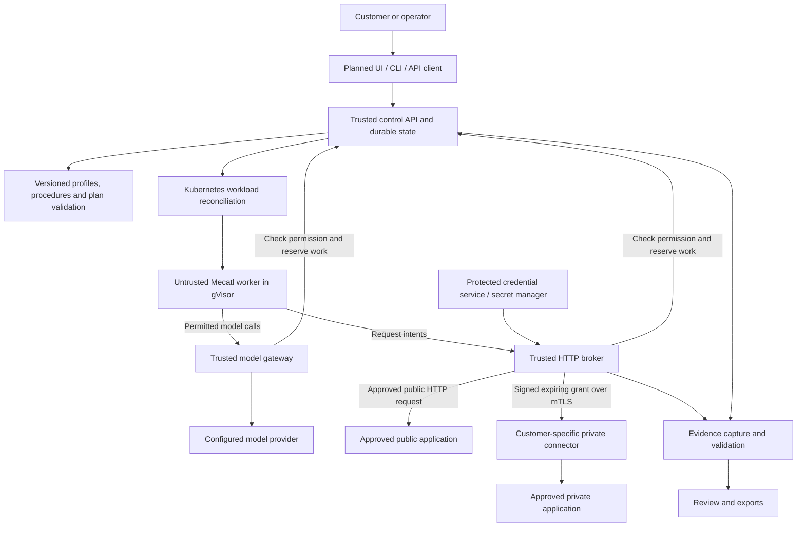

# Tsunami: product design and user journey

Updated: 2026-11-04.

This document describes the intended product and connects it to the current prototype. **Implemented**, **partial** and **planned** describe different levels of readiness. Future screens, endpoints and workflows below are not existing features unless marked implemented.

The implementation status is in [track.md](track.md). Recorded experiments are in [validation-results.md](validation-results.md). This document does not replace those limits or make the project customer-ready.

## 1. What the product should do

A customer should be able to register an application, provide approved access, choose a testing profile, approve the boundaries and start an assessment. Tsunami should select applicable built-in tests, run permitted operations, preserve evidence and explain the result.

The customer should not have to type instructions such as “try reading Alice's book as Bob.” That is test logic supplied by Tsunami.

For the first usable product slice, the target is HTTP/HTTPS web applications and APIs. It should offer a complete, bounded authorization-testing workflow. Broader web testing, network scanning, VM/MCP execution, mobile, cloud, crypto and specialist-agent coordination remain separate stages. A URL alone cannot promise complete coverage of an unknown application.

An incoming assessment request creates background work. Tsunami is not currently a WAF or a service that inspects every normal visitor request to the target application.

## 2. Scope, profiles and tests are different things

| Term | Meaning | Example |
|---|---|---|
| Scope | Where Tsunami may act, which identities/actions it may use, and the limits | This application, approved routes and destinations, two test accounts, bounded reads, a test window and request budget |
| Profile | A built-in group of testing capabilities | Web/API authorization testing |
| Procedure | A built-in test with prerequisites, permitted actions and evidence rules | Check whether an ordinary user can read another user's private object |
| Plan | Procedures selected and bound to this application's approved permissions and known facts | Use two accounts and their legitimate objects; run the applicable cross-user check |
| Engagement | The approved assessment containing scope, plan references, runs and evidence | Today's authorization assessment of the books application |
| Run | One execution of an approved procedure | One object-access test attempt |

“Selected assessment scope through guided onboarding” means a short setup flow that turns the customer's choices into explicit backend permissions. It does not mean asking the customer to write attack prompts.

The profile can have recommended defaults. Customers may exclude features, choose permitted impact levels and review the plan; advanced users may choose individual tests. Routine requests within the approved plan should not require a new approval for each packet.

Selecting a profile does not grant permission to every operation it contains. Missing credentials, unsupported authentication, insufficient business context or an excluded action can make a procedure unavailable. Tsunami must explain why it cannot run that test rather than silently claiming coverage.

Customer choices can narrow platform permissions and limits. They cannot enable an unsupported executor or raise allowances beyond platform ceilings. These checks belong on the server, including for direct API callers.

## 3. What the customer supplies, and what Tsunami supplies

| Customer supplies | Tsunami supplies |
|---|---|
| Approved application and evidence/reference of authorization | Target validation, permission records and an approval workflow |
| Allowed and excluded hosts/routes/actions; operating window | Compiled scope rules and enforcement outside the agent |
| Dedicated test identities and their roles, through a protected credential flow | Credential references/aliases and controlled delivery to the execution boundary |
| Intended access rules where needed, such as private versus shared records | Built-in authorization tests and evidence validation |
| Optional API specification, application notes and suitable test data | Bounded inventory/discovery and selection of supported tests |
| Approved limits and data/model handling choices | Scheduling, quotas, Stop, evidence collection and reporting |

For a cross-user test, Tsunami needs two suitable identities and legitimate objects. It should obtain those through approved discovery or guided setup where possible. The customer should not need to provide proof hashes or hand-write JSON selectors in the intended UI.

Tsunami cannot reliably infer every business rule. Different owners do not automatically imply forbidden access: a shared record may be intentionally readable. When the intended rule or identity/object relationship is unclear, ask for clarification or report an inconclusive result.

Creating accounts or records is a separate action. A read-oriented assessment must not silently create test data. Use customer-provided disposable records or an explicitly approved setup workflow. Our current VAmPI helper seeds only our owned disposable lab.

## 4. Intended user journey

### Step 1: Sign in and select a workspace — planned

The user signs in and works inside a customer workspace. Backend identity determines the tenant; a tenant ID supplied in a request body cannot grant access.

Roles should distinguish who can configure applications, approve assessments, run them, review findings and administer the platform. The current random demo tenant tokens do not implement this customer identity system.

### Step 2: Add an application — planned onboarding; startup registration exists

The user enters the application URL, public/private connectivity and permitted boundaries. For private applications, they select a connector belonging to their workspace.

The backend checks syntax and configuration locally. A target connection, login check or discovery request must have an explicit bounded preflight permission first. Merely typing a URL must not cause unrestricted network requests.

Ownership/authorization verification and its operational process still need a product decision. A checkbox or an LLM interpreting “I am authorized” cannot establish authority. Current engagements record an operator authorization reference; they do not verify legal documents automatically.

Today, application registration is a trusted startup file. There is no existing `POST /v1/applications` onboarding endpoint.

### Step 3: Connect test accounts and describe access rules — planned guided flow

For authorization testing, the user adds two test accounts, labels their roles and describes relevant sharing rules. A future protected setup flow should validate that they are distinct identities and can access their own test data.

Credentials should go through the trusted credential service. They must not be pasted into agent prompts, ordinary logs or general report metadata. Show credential status and expiry without revealing stored values.

Today the configured profile supports two broker-held bearer credentials and explicit identity/object assertions. General browser login, cookie sessions, SSO and automatic credential refresh are not implemented.

### Step 4: Choose a testing profile — planned product selection

The user selects **Web/API authorization testing**, with a clear explanation of allowed actions and prerequisites. Tsunami selects applicable procedures from its built-in catalog.

The initial catalog ideas include object ownership, intentional sharing, administrator boundaries, anonymous access and missing-object controls. Their current implementations are narrow engineering procedures, not complete coverage of those vulnerability classes or a security standard.

The UI should explain exclusions and unavailable tests before launch. “Run every test” must not enable unsupported tools, state-changing actions or raw network access.

An illustrative future form could look like this; it is not an existing screen:

```text
Application:       https://books.example.test
Testing profile:   Web/API authorization
Test accounts:     Owner account + peer account
Sharing rule:      Selected records are private unless explicitly shared
Excluded actions:  Delete records, reset accounts, trigger payments
Next:              Review permissions and applicable built-in tests
```

The URL above is an example. The built-in catalog contains the cross-user test; the user does not write its request sequence.

### Step 5: Build and approve a plan — partly implemented

Tsunami combines the profile, application facts, credential aliases and limits into a versioned plan. The user reviews a short summary: targets, identities/roles, permitted operations, exclusions, expiry, limits and data handling.

Optional discovery must stay inside an already approved discovery permission. Specifications, discovered links, redirects and tool output are untrusted inputs. They cannot approve another host or action. External references must not be fetched automatically outside the approved path.

An agent may propose tests, but the backend checks eligibility and permission. A scope expansion needs explicit approval; the current immutable engagement design uses a new engagement for changed scope. Future product APIs must preserve this property or introduce a reviewed versioned equivalent.

Today engagements pin registered application plans or selected embedded procedure versions. Automatic profile selection and discovery-based plan generation are not implemented.

### Step 6: Start and monitor — core execution implemented; UI planned

Starting an assessment returns an ID promptly. Durable state records the work and reserves its allowance. The controller creates the permitted Kubernetes workload; the worker runs the selected task through Mecatl.

The user sees queued/running work, procedure outcomes, skipped/unavailable tests, request/model usage and failures. The UI must distinguish permission/state from actual process readiness; the current run `running` transition records dispatch intent before a worker necessarily starts.

An unsupported task is refused. Interrupted or ambiguous operations are not automatically replayed just because a Job disappears. Retrying an assessment requires a new permitted attempt with its own reservation.

### Step 7: Stop when needed — foundation implemented; wider qualification pending

The user can stop a run or engagement. Customer administrators can stop their workspace; platform administrators can stop everything.

The backend persists revocation, denies new actions, cancels tracked requests and asks Kubernetes/executors to clean up. The UI should show **permission revoked**, **active requests draining** and **cleanup pending/confirmed** separately. It must not report complete cleanup merely because Kubernetes accepted deletion.

Target-side actions already performed cannot be undone. Some external work or provider billing may continue after the client disconnects. The under-one-minute objective needs measurements under stated failure and load conditions; it is not a verified production guarantee.

### Step 8: Review evidence, export and retest — partial

The user sees what was tested, the supporting request/response evidence, unavailable or inconclusive tests, and confirmed findings after review. A clean result means no issue observed by the completed tests, not that the application is secure.

Raw candidates remain separate from review decisions. A reviewer supplies impact/rating judgment; the backend calculates the supported CVSS score from the explicit vector. Model prose is not proof. Current example confirmations are labeled `automated_lab_test`.

Exports should respect customer access and data rules. A retest creates new evidence and preserves the previous observation/history. Full remediation/retest workflow, individual reviewer identity and customer evidence lifecycle remain planned.

## 5. Concrete example: a built-in cross-user access test

The following is the intended experience; the existing VAmPI lab implements a configured subset of it.

1. The customer registers a books API and chooses authorization testing.
2. They supply two test identities and state that the selected book records are private unless explicitly shared.
3. Tsunami obtains appropriate legitimate objects through approved setup/discovery. If it cannot establish them, it asks for help or skips the test with a reason.
4. The built-in procedure checks both identities and their legitimate reads.
5. It requests the owner's private object using the peer identity, then rechecks the owner object and peer session.
6. The validator compares actual evidence and the intended rule. A generic HTTP 200 or an expired session is insufficient.
7. The user sees a supported finding candidate, no issue observed, or an inconclusive result with missing prerequisites explained.

The customer never types “make Bob read Alice's record.” Tsunami supplies that test method. Customers provide permission and application facts; they do not have to know or identify the bug beforehand.

The current `http-object-access/v2` profile is more manual: identity/object paths, assertions and proof hashes are configured in advance. Removing that setup burden while retaining trustworthy validation is work still to do. The latest configured-application campaign uses scripted Mecatl; it is not autonomous discovery.

## 6. Architecture and trust boundaries



The boxes describe responsibilities, not a requirement to deploy a separate service for each box. Today the API, controller, broker, validator and model gateway share one trusted process with bbolt. The customer UI, profile planner, external secret service and customer-grade evidence storage are planned.

The public configured-application path and private synthetic-catalog path exist separately. Private configurable applications and private live-model assessments are not currently supported. The diagram shows the intended common architecture, not current feature parity.

The worker, target content, model output, uploaded artifacts and tool output are untrusted. The control plane, enforcement services, Kubernetes/runtime/network layer, credential/evidence services and private connectors are trusted components. A compromise of one of those trusted components can invalidate its protection.

### Isolation and command execution

Use isolated customer execution boundaries and a tested gVisor RuntimeClass for compatible HTTP tools. Keep trusted services separate from worker execution nodes where practical. Non-root workloads, dropped capabilities, read-only roots, bounded writable space and no Kubernetes API token reduce worker access.

Enforced networking must allow only required trusted services. Namespace names, proxy environment variables and agent prompts do not provide this guarantee. Test startup as well as settled traffic, with reachable controls. Standard NetworkPolicy alone does not implement HTTP scope or give uniform node/metadata behavior across all Kubernetes setups.

The existing native worker has a scratch image. The optional tools image runs only a fixed shell/curl adapter; no general shell tool is registered. Curl sends JSON over a private Unix socket to a Go bridge. The broker performs the actual target GET. Unmodified target-facing curl commands do not automatically work through it.

A compromised worker can read its own run credential and try permitted services directly. Backend authorization must still restrict it to that run. Process groups help terminate ordinary command descendants; hostile session creation, PID/resource exhaustion and complete process cleanup need separate qualification.

### Scope and private connectivity

For HTTP, validate the request at the broker, independently of the agent. Check approved origin, method/path/account permissions, port and actual destination address. Use the validated address for dialing; verify upstream TLS for HTTPS. Validate redirect destinations before further requests and never treat a discovered link as authorization.

Changing DNS answers require an explicit destination policy; a DNS response alone must not grant new permission. Shared hosting/CDN addresses do not authorize other hostnames or services on those addresses. Metadata, Kubernetes services, other tenants and infrastructure addresses require explicit exclusions and deployment tests.

Private connectors belong to a customer and have no direct/public fallback. The existing connector checks signed single-use grants, local scope, expiry and replay state over an authenticated mTLS link. Customer-side routes, partitions and broader configured-app support still need work. A compromised connector can misuse its own access or forge returned evidence; TLS does not solve that.

Remote MCP tools and other services that fetch URLs are also execution boundaries. They must enforce the same relevant permissions at their actual network connection. The agent's restricted pod network does not constrain a remote service acting on its behalf.

### Secrets, evidence and models

Keep target/provider credentials outside the worker where the tool interface permits it. Use short-lived, least-privilege test access. A future secret manager and possibly ESO can deliver component secrets; neither is implemented here. A compromised recipient can still misuse its own assigned credential.

Returned data can echo credentials or contain personal information. Before customer use, restrict artifact access, redact appropriately, encrypt storage, define deletion/retention and backups, and approve any model disclosure. Avoid sensitive request/response bodies in normal logs and traces. General redaction is not implemented in the prototype.

Provider keys stay at the model gateway. Model output and target text cannot change policy or enable hosted/remote tools outside the controlled path. Development model use remains explicitly free-only without paid fallback. Current configured applications do not permit live inference.

Evidence hashes identify exact bytes. They do not prove authenticity against a compromised broker or connector. Validators need suitable typed assertions and known prerequisites; ambiguous results require review instead of stronger claims.

### Stop, limits and failures

Durable permission is separate from the existence of a Kubernetes pod. Reconciliation must never restore revoked permission. Existing local request tracking cancels active HTTP/model operations; remote executors need local expiry and revocation enforcement as well.

If authorization/state cannot be checked, deny new work. If a model, Redis limiter or budget service is unavailable in a future distributed deployment, do not silently use an unlimited fallback. Keep Stop outside normal work queues. A Kubernetes outage may delay cleanup even when the broker can revoke and cancel locally.

The existing private connector has a persisted emergency cutoff independent of the normal broker Stop request. It still trusts the connector and its management path. An external emergency egress cutoff and broader outage/partition qualification remain work.

Cap requests, time, concurrency, process resources, tool output and model calls. Production spend needs durable reservations and unknown-cost reconciliation before/after model calls. Redis could coordinate distributed limits and OpenMeter could meter usage, but neither replaces budget authorization; neither is implemented in Tsunami. No 1,000-agent capacity result exists.

## 7. How an assessment request becomes agent work

The design combines a few simple patterns:

| Pattern | How Tsunami uses it |
|---|---|
| Asynchronous job workflow | The API records approved work and returns an ID; execution happens in the background. |
| Controller reconciliation | Compare durable run permission/state with Kubernetes workloads; create once or clean up without reopening stopped work. |
| Built-in procedure catalog | Reuse versioned test definitions and evidence rules instead of asking customers to write attack instructions. |
| Bounded agent loop | Observe approved facts, select a permitted tool call, inspect its result, continue within limits and finish. |
| External policy enforcement | Trusted services authorize every operation even if the worker ignores its prompt. |
| Tool/executor adapters | Give different clients a controlled interface; HTTP, VM, network and device work need appropriate separate boundaries. |
| Evidence-based validation | Backend checks captured observations and prerequisites; review determines supported impact. |

The intended flow is:

```text
Customer request
  -> authenticate workspace and record draft scope
  -> select eligible built-in procedures
  -> compile and approve a bounded plan
  -> reserve work and create runs
  -> reconcile isolated execution
  -> Mecatl calls permitted tools through trusted enforcement
  -> capture evidence and validate outcomes
  -> review, export and optionally retest
```

An LLM may help propose applicable procedures or choose the next permitted action. Deterministic code checks permission, reservations, supported schemas and evidence. The agent must not mint credentials, approve its own scope, spawn unrestricted children, change verdicts or reset budgets.

Today scripted providers drive configured application tests. Live inference exists for supported synthetic catalog workflows. Both use the real Mecatl loop, but scripted success is not a measurement of LLM discovery quality. A future live application mode needs its own data-handling review and quality evaluation.

Future specialist coordination should be service-owned: tasks receive narrow permissions and tenant-bound artifact references, with aggregate Stop/budgets. The eight toolkit roles are currently references, not implemented autonomous specialists.

## 8. Existing APIs: a usable backend journey today

All operator routes below require tenant operator authentication. Worker routes use a different credential bound to one run. There is no general customer sign-in/UI or natural-language assessment endpoint today.

| Step | Existing endpoint | Current behavior |
|---|---|---|
| List configured applications | `GET /v1/applications` | Public plans for this tenant; no target credentials |
| Create draft | `POST /v1/engagements` | Select a registered application or supported fixture procedures |
| Approve | `POST /v1/engagements/{id}/approve` | Approve the pinned scope; does not itself launch a worker |
| Start procedure | `POST /v1/engagements/{id}/runs` | Reserve/create a child and return its run ID |
| Follow assessment | `GET /v1/engagements/{id}` | Scope, child links and derived progress |
| List run history | `GET /v1/runs?limit=50&cursor=...` | Tenant-bound metadata page (`items`, optional `next_cursor`); full evidence stays on individual runs |
| Follow run | `GET /v1/runs/{id}` | State, captures, result and usage where available |
| Stop run | `POST /v1/runs/{id}/stop` | Persist revocation and cancel tracked work |
| Stop engagement | `POST /v1/engagements/{id}/stop` | Revoke active children and prevent new children |
| Stop tenant | `POST /v1/stop-tenant` | Revoke this authenticated tenant's work and latch its gate |
| Stop everything | `POST /v1/stop-all` | Requires the separate global operator credential |
| Review candidate | `POST /v1/engagements/{id}/reviews` | Requires a stopped engagement, matching evidence and revision |
| Export | `GET /v1/engagements/{id}/export` | Evidence bundle and report draft |
| Download findings CSV | `GET /v1/engagements/{id}/findings.csv` | Reviewed findings |

For the existing lab, create a draft with `application: vampi-vulnerable`, approve it, then start `assessment: vampi-vulnerable/object-access/v2` with `execution: scripted`. There is no `profile` selector on this API yet. `executor: curl-http/v1` is an optional engagement choice only when the reviewed tool feature is enabled; omitting it uses the native path.

Inside the worker, `GET /v1/runs/{id}/config` loads the approved plan. `POST .../request` submits an HTTP intent, `POST .../finish` asks for validation, and the optional `POST .../model` uses the permitted model gateway. The worker token cannot access operator approval/review routes or another run. Target credentials are added at the broker, not supplied by those intents.

### Proposed API additions — not implemented

The exact contracts need implementation review. The product needs protected application/account onboarding, a profile catalog, prerequisite checks, a plan preview/approval flow, customer identity/roles and audit. These can extend the existing versioned APIs; names below are sketches only:

| Proposed operation | Possible endpoint | Purpose |
|---|---|---|
| Register an application | `POST /v1/applications` | Replace manual startup-only onboarding |
| List eligible profiles | `GET /v1/profiles` | Show supported tests, required access and impact |
| Prepare a plan | `POST /v1/engagements/{id}/plan` | Select/bind procedures inside recorded permissions |

Credential onboarding should use protected references and dedicated permissions. Unsupported authentication/discovery must be reported explicitly. A future natural-language entry point may help fill out the form, but only the validated, approved backend plan can grant execution permission.

## 9. UI plan

**Yes, a small UI is part of the proposed product. It is not implemented yet.** A CLI and UI should use the same backend APIs. Security checks must remain effective when someone bypasses the UI and calls the API directly.

| Screen | What the user does |
|---|---|
| Applications | Register a target, set public/private connectivity, manage test-account references and view credential health |
| New assessment | Select a built-in profile, review prerequisites, permissions, exclusions, limits and data handling; approve/start |
| Assessment detail | Follow tests and usage, see unavailable/inconclusive work, inspect denials and press Stop |
| Findings and evidence | Review supporting observations, record a disposition and impact, export and request retest |

For the first UI slice, use preconfigured owned applications while new onboarding/security APIs are built. It should show the real current backend results and clearly label scripted versus model execution. A button must not imply unsupported automatic discovery.

Use simple status polling first. Keep Stop visible and available during running or failing work. Do not put all progress messages into a chat transcript. Render target/tool content as untrusted text and enforce tenant/evidence permissions on the server. Do not return stored target/provider secrets to the browser or put them in URLs, local storage or logs. Any credential-input form needs a protected flow to the authorized backend; client session handling is a separate identity decision.

The UI framework, customer identity provider and session details are open implementation choices. No separate orchestration framework, general remote shell or large dashboard is required to explain the first workflow.

## 10. Current demonstration and next delivery

The owned VAmPI vulnerable/fixed campaign already demonstrates the configured seven-read check, a rejected scope attempt, linked evidence and exports. The optional curl execution has recorded selected network bypass denials with reachable controls. See [the actual results](../examples/tool-execution/README.md).

For a coherent next product delivery:

1. Keep the existing supported procedure and make launch/status/stop/report understandable through a small CLI/UI over the APIs.
2. Add guided prerequisite/plan presentation so users choose an assessment category rather than write test instructions. Initially use owned preconfigured applications; do not claim arbitrary URL onboarding.
3. Qualify active-request Stop with actual gVisor workers and record separate revocation, cancellation and cleanup observations.
4. Improve one useful built-in HTTP test/application adapter and reduce manual application-specific assertions with reviewed evidence rules.
5. Add live application-agent behavior only with synthetic-data controls, bounded permissions and separate evaluation. Retain scripted runs as repeatable infrastructure checks.
6. Complete customer identity, secret/evidence protection, private connectivity and failure qualification required for a limited pilot before accepting real customer data.

The broader toolkit-inspired profiles and scale work continue through the stages in [product-roadmap.md](product-roadmap.md). They do not become supported because they appear in a profile list or UI. A customer-ready claim depends on the tested profile and its operational controls, not feature count.

## 11. Decisions and inputs still open

- Which useful web/API procedure and authentication flow to support next.
- How to obtain trustworthy application identity/object/sharing facts without manual proof hashes.
- Destination policy for changing public DNS/CDN addresses and real private customer routes.
- Customer authorization verification, roles, model disclosure and retention agreements.
- UI/session implementation, durable multi-replica storage and production evidence/secret services.
- Toolkit redistribution terms, the friend's actual VM/MCP contracts, mobile platform needs and an approved capacity-test environment/budget.

These are explicit future decisions. Existing lab results do not establish complete isolation, general vulnerability discovery, a production 60-second Stop guarantee or 1,000-agent capacity.
