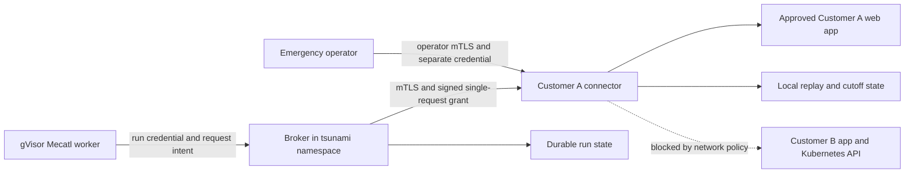

# Private connector lab

This milestone moves a synthetic customer's web apps behind a separate execution point. The later transport milestone adds mutual TLS between broker and connector. It is still one local Kubernetes cluster, not a tunnel into a real customer network. No external target or model is needed.

## Request path



Workers use the same two broker tools. They cannot contact private apps or connectors directly on the tested paths. The normal public lab path remains available. An authenticated operator must select `connectivity: private`; a worker cannot choose that route or another tenant.

The broker binds the private route to `demo-a`. Its signing key is mounted only in the control-plane pod. The connector in `tsunami-customer-a` has the public verification key and its own emergency credential. A fixture in `tsunami-customer-b` supplies a cross-customer negative test. Customer B has no configured private route in this prototype.

## Why a second scope check

The broker validates the origin, port, path, and account before granting a request. It reserves request quota before dispatch. The connector validates them again, resolves the hostname locally, checks every answer against its configured exact IP approvals, and dials a checked numeric address. DNS cannot select a different destination after that check. The local setup installs exact Service IPs as explicit lab approvals; this is not a customer target-approval system.

The connector accepts a small signed request format, not CONNECT tunnels or an unrestricted forward proxy. Only GETs to the existing fixture catalog are supported. Synthetic account credentials are attached at the connector. Arbitrary headers, methods, bodies, and shell tools are not supported.

Redirects are returned without following them. The broker validates the next hop and issues a new grant; the connector validates it again before opening a connection. There is no direct-network fallback when the connector is unavailable. The broker captures the connector response and actual destination peer, then uses the same known-owner validator.

The connector is trusted. Its compromise could expose its customer's approved lab apps and forge evidence returned to the broker. Its public key cannot mint grants, and its tested egress rules block Customer B and API paths. Those rules do not protect Customer A from its own compromised connector. Broker-to-connector traffic now uses customer-specific TLS identities; the real customer version still needs customer-side deployment, the other internal transport links, and independent network controls.

## Permissions, stopping, and partitions

Each Ed25519-signed grant binds one request ID, run, tenant, connector audience, URL, account, issue time, and expiry. The signed lifetime is at most ten seconds and cannot exceed the run or operation deadline. Grants are never sent to workers.

Before opening a connection, the connector atomically consumes the request ID in its local bbolt store. Replaying the same grant, including after a restart, is denied. Failed or ambiguous requests are not automatically retried with that grant. Replay state is bounded; the connector refuses admission if it cannot safely store it.

Normal Stop still persists run state before acknowledging it. It cancels the broker context, which normally closes the connector request and cancels the target request. Run, tenant, and global Stop use the same path. Kubernetes cleanup remains separate and cannot grant permission again.

If cancellation cannot reach the connector, its local request deadline expires without consulting the broker. This is a **single-request permission**, not a renewable session lease. A request still valid when Stop was accepted can continue until expiry if the connection is partitioned. Correct clocks and a functioning connector process/runtime are trusted; the verifier allows 250 ms of issue-time clock skew. Scheduling, clock failure, frozen processes, and every network partition have not been qualified.

The emergency endpoint uses a separate operator TLS identity and bearer key and persists a connector-local cutoff before acknowledging it. It cancels active contexts and denies all later grants, including after restart. It does not call the normal Stop API. There is intentionally no agent-accessible resume endpoint, and redeployment does not clear the cutoff.

This is independent of the broker process, **not an external firewall cutoff**. The local helper uses Kubernetes port-forward, so it still needs the Kubernetes API and connector to be reachable. If both management paths fail, local expiry remains the bound we rely on. A compromised connector can ignore its own cutoff; an independently administered network cutoff remains future work. Cancellation never rolls back target-side effects.

## Reproduce

```sh
export KUBECONFIG="$PWD/.local/sandbox.kubeconfig"
export CONTEXT=kind-tsunami-lab RUNTIME_CLASS=gvisor
make private-deploy CONTEXT=kind-tsunami-lab
make private-verify CONTEXT=kind-tsunami-lab

# Run after the outage test has restored the connector, not alongside it.
PROBE_PRIVATE=true make network-check CONTEXT=kind-tsunami-lab RUNTIME_CLASS=gvisor
make connector-network-check CONTEXT=kind-tsunami-lab
```

Setup creates only this project's private lab namespaces/resources in the dedicated cluster. It generates signing/emergency credentials through stdin, preserves existing credentials and state, and saves the non-secret manifests/config under `artifacts/private/`. Config changes restart the connector/control plane; make them between assessments. The regular public verifier stays scripted, including when the free model is configured.

To exercise the emergency path manually, first stop any unrelated private lab assessment:

```sh
CONTEXT=kind-tsunami-lab python3 scripts/emergency-cutoff.py
```

This leaves the connector disabled. Restarting or running setup again will not reset it. Recovery requires a deliberate operator-controlled state replacement/reprovision; there is no automated reset in this prototype. Never delete replay/cutoff state during an active assessment.

## Evidence and limits

The Kubernetes suite verifies vulnerable, fixed, missing-object, redirect, and Stop scenarios through gVisor workers and the connector. It also checks that Customer B cannot create a private run and that an offline connector results in no private target traffic. Network tests bracket runner/connector identity probes with trusted positive controls.

Native race-enabled tests verify signature/tenant/audience/target rejection, replay protection after restart, independent expiry during an active request, durable emergency cutoff during an active request, all three Stop levels, redirect denial, and no direct fallback. These are local HTTP tests; emergency cutoff and partitioned-request expiry have not yet been measured between separate Kubernetes nodes. See [recorded examples](../examples/private-connectivity/README.md).

The original records below used HTTP with signed grants. The current broker-to-connector link uses mutual TLS; see [identity, expiry, and renewal limits](connector-tls.md). Worker/broker and connector/fixture links remain HTTP with synthetic secrets/data. Customer evidence still requires a wider transport, identity lifecycle, retention, and failure review.

The namespace boundary is not a separate VPC or VM. DNS access is a trusted infrastructure dependency; allowing the connector to use a recursive resolver does not prevent DNS tunnelling by a compromised connector. Workers still have no direct DNS access on the tested paths. IPv6, metadata, arbitrary protocols/interfaces, hostile connector escapes, multi-node partitions, real private tunnels, model-driven private assessments, and production stop guarantees are unqualified. Shell execution remains disabled.
